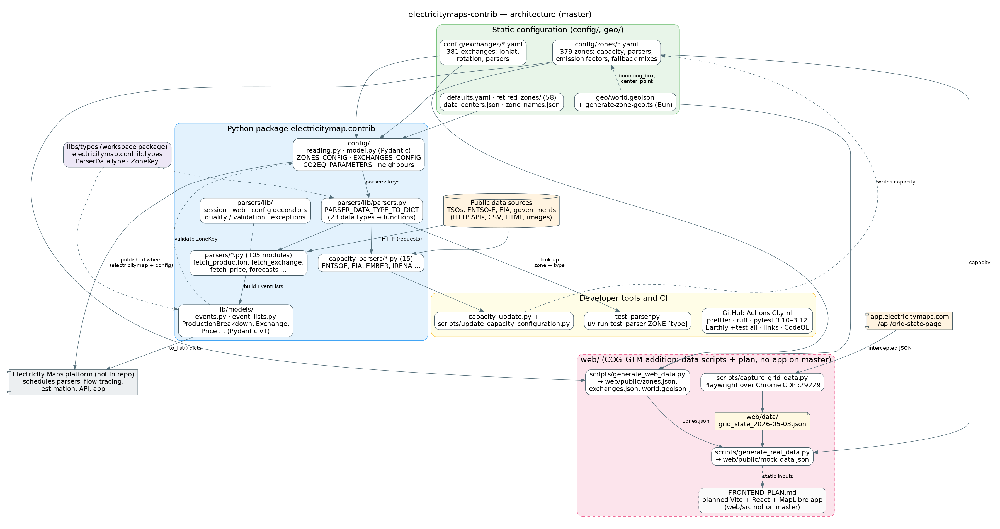

# Architecture

This page describes how `electricitymaps-contrib` is put together on the default branch (`master`) of the COG-GTM fork. The repository is a data-collection layer: it holds static zone and exchange configuration, a Python package of parsers that fetch and normalise electricity data, and the tooling around them. The scheduler, flow-tracing, estimation models, API and app that consume this package run in the Electricity Maps platform and are not in this repository. The COG-GTM fork adds `web/`, which holds data-generation scripts and a frontend build plan, but no runnable web app.

The diagram source is [`diagrams/architecture.dot`](diagrams/architecture.dot) (Graphviz). Edit it and run [`diagrams/render.sh`](diagrams/render.sh) to refresh [`architecture.png`](diagrams/architecture.png) and [`architecture.svg`](diagrams/architecture.svg).

## Components

| Path                                                                                                                    | Role                                                                                                                                                                                                                                                                                                                                                                                                                                  |
| ----------------------------------------------------------------------------------------------------------------------- | ------------------------------------------------------------------------------------------------------------------------------------------------------------------------------------------------------------------------------------------------------------------------------------------------------------------------------------------------------------------------------------------------------------------------------------- |
| `config/zones/*.yaml`                                                                                                   | 379 zones. Each file holds the zone's capacities over time, the parser for each data type (`parsers:`), emission factors, fallback mixes, bounding box, timezone and contributors.                                                                                                                                                                                                                                                    |
| `config/exchanges/*.yaml`                                                                                               | 381 exchanges (links between two zones, file name `A_B.yaml`). Each holds the map position (`lonlat`, `rotation`), capacity and parsers.                                                                                                                                                                                                                                                                                              |
| `config/defaults.yaml`, `config/retired_zones/` (58), `config/data_centers/data_centers.json`, `config/zone_names.json` | Default emission factors, zones no longer shown, data-centre locations, and display names.                                                                                                                                                                                                                                                                                                                                            |
| `geo/world.geojson`, `geo/generate-zone-geo.ts`                                                                         | Zone polygons. The Bun script recomputes `bounding_box` and `center_point` in each zone YAML from the polygons.                                                                                                                                                                                                                                                                                                                       |
| `electricitymap/contrib/config/`                                                                                        | Reads the YAML once at import (`reading.py`), validates it with Pydantic models (`model.py`), and exposes globals such as `ZONES_CONFIG`, `EXCHANGES_CONFIG`, `RETIRED_ZONES_CONFIG`, `CO2EQ_PARAMETERS` (lifecycle and direct) and `ZONE_NEIGHBOURS`.                                                                                                                                                                                |
| `electricitymap/contrib/parsers/lib/parsers.py`                                                                         | Builds `PARSER_DATA_TYPE_TO_DICT` at import: for every `parsers:` entry in the zone and exchange configs it imports `Module.function` and registers it under its `ParserDataType` (23 data types in use).                                                                                                                                                                                                                             |
| `electricitymap/contrib/parsers/*.py`                                                                                   | 105 parser modules (for example `ENTSOE`, `EIA`, `ECO2MIX`, `AEMO`). Each exposes `fetch_production`, `fetch_exchange`, `fetch_price`, forecast functions and so on, taking `zone_key`, `session`, `target_datetime` and `logger`. Retired parsers live in `parsers/archived/`; the template is in `parsers/examples/`.                                                                                                               |
| `electricitymap/contrib/parsers/lib/`                                                                                   | Shared helpers: HTTP helpers (`web.py`, `session.py`), decorators (`config.py`: `refetch_frequency`, `retry_policy`, `use_proxy`), production/storage mode enums, `quality.py` and `validation.py` checks, `ParserException`.                                                                                                                                                                                                         |
| `electricitymap/contrib/capacity_parsers/*.py`                                                                          | 15 installed-capacity parsers (`ENTSOE`, `EIA`, `EMBER`, `IRENA`, …), registered under `productionCapacity`.                                                                                                                                                                                                                                                                                                                          |
| `electricitymap/contrib/lib/models/`                                                                                    | Pydantic (v1) event models in `events.py` (`ProductionBreakdown` with `ProductionMix`/`StorageMix`, `Exchange`, `TotalConsumption`, `Price`, `LocationalMarginalPrice`, `GridAlert`, `ExchangeCapacity`, …) and lists of them in `event_lists.py`. Events check that `zoneKey` exists in `ZONES_CONFIG` or `RETIRED_ZONES_CONFIG` and that datetimes are timezone-aware and plausible; `to_list()` produces the dicts parsers return. |
| `libs/types/`                                                                                                           | A uv workspace package, `electricitymap.contrib.types`, with `ParserDataType`, `ZoneKey` and other shared types.                                                                                                                                                                                                                                                                                                                      |
| `test_parser.py`                                                                                                        | `uv run test_parser ZONE [data-type]` looks a parser up in the registry, runs it live and prints and sanity-checks the result.                                                                                                                                                                                                                                                                                                        |
| `capacity_update.py`, `scripts/`                                                                                        | `uv run capacity_update --zone … / --source …` runs capacity parsers and rewrites the capacity section of the zone YAML files. Other scripts create aggregated zones, remove zones, sync zone names and validate config file names.                                                                                                                                                                                                   |
| `web/` (COG-GTM)                                                                                                        | `web/scripts/` turns repo config and a captured grid snapshot into static JSON for a frontend; `web/FRONTEND_PLAN.md` describes that frontend (Vite, React, MapLibre, Recharts). The frontend source (`web/package.json`, `web/src/`) is not on `master`.                                                                                                                                                                             |

## Data flow

1. **Configuration load.** Importing `electricitymap.contrib.config` reads every zone, exchange, retired-zone and data-centre file from `config/` and computes emission-factor parameters, bounding boxes, parents and neighbours.
2. **Parser registration.** Importing `electricitymap.contrib.parsers.lib.parsers` walks the `parsers:` keys of each zone and exchange config and fills `PARSER_DATA_TYPE_TO_DICT[ParserDataType][zone_or_exchange_key]`.
3. **Fetch.** A caller (the Electricity Maps platform, or `test_parser` locally) picks the function for a zone or exchange (`"DE"`, `"DE->FR"`) and data type and calls it. The parser requests data over HTTP from a TSO, ENTSO-E, EIA or other public source.
4. **Normalise and validate.** The parser builds events such as `ProductionBreakdown` (MW per mode) or `Exchange` (net flow) inside an `EventList`. Validation drops or corrects bad points (negative production, naive or future datetimes, unknown zones).
5. **Hand-off.** The parser returns `EventList.to_list()` dicts. The platform turns them into carbon intensity using the emission factors from `config/` and runs flow-tracing; that part is not in this repository.

Capacity data takes a separate path: `capacity_update` runs a capacity parser and writes new dated capacity entries back into `config/zones/*.yaml`, which are reviewed and merged as config changes.

## Web data scripts (COG-GTM)

The scripts in [`web/scripts/`](../web/scripts/README.md) produce the static inputs listed in `web/FRONTEND_PLAN.md`:

1. `generate_web_data.py` reads `config/zones`, `config/exchanges` and `geo/world.geojson` and writes `web/public/zones.json` (379 zones), `exchanges.json` (381 exchanges) and a copy of `world.geojson`.
2. `capture_grid_data.py` connects to a Chrome instance on CDP port 29229, opens app.electricitymaps.com and saves the `/api/grid-state-page` responses it intercepts (default `/tmp/real_timeseries.json`).
3. `generate_real_data.py` reads a captured snapshot (default `web/data/grid_state_2026-05-03.json`), `web/public/zones.json` and the zone capacities and writes `web/public/mock-data.json`. Run `generate_web_data.py` first, because this script reads its `zones.json`.

## Build, test and CI

- **Setup:** `uv sync --group dev --extra parsers` (Python 3.10 per `.python-version`; the dev container also adds `--group scripts`). Some parser tests need `tesseract-ocr` and `libxml2`.
- **Checks:** `uv run check` runs `ruff format --check`, `ruff check` and `pytest`; `uv run format`, `uv run lint` and `uv run test` run them separately. Pre-commit runs Ruff (`.pre-commit-config.yaml`).
- **CI** (`.github/workflows/CI.yml`): Prettier 2 check of the whole repo, Earthly `+test-all` (builds the package image and runs `uv run check`), Ruff, pytest on Python 3.10, 3.11 and 3.12, config file-name validation, local Markdown link validation and CodeQL.
- **Containers:** `Earthfile` defines the build and test targets; `parsers.dockerfile` builds an image whose entry point is `uv run test_parser`.
- **Packaging:** the Hatch wheel and sdist include `electricitymap/` and `config/` (tests and dev scripts excluded); the platform consumes this published package.
